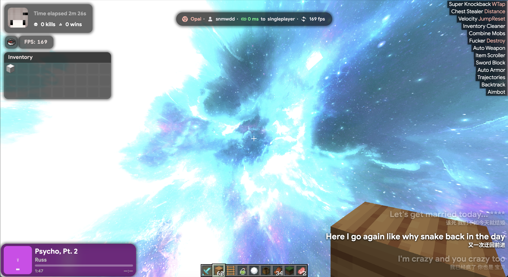

# OpaiBounce
[简体中文](README简体中文.md)
# The Script Must Be Installed for the Theme to Function Properly

https://github.com/snmwdd/OpaiBounce/tree/main/script



# [More Images](https://github.com/snmwdd/OpaiBounce/tree/main/images.md)

## Requirements

- Node.js 22+ and npm.
- Python 3.11+.
- JDK 21+, with both `java` and `javac` available in PATH. The music service is compiled to Java 21 bytecode.
- An internet connection is required during the initial setup to download npm dependencies and Gson 2.11.0. Gson is downloaded from Maven Central and verified against a fixed SHA-256 hash. At runtime, Gson is provided by the game client.

## Development & Build

```sh
npm ci
npm run dev
```

You can preview the main menu in a browser at `http://localhost:5173/#/title?static&preview`. Real-time game data and native rendering require LiquidBounce and the companion script.

```sh
npm run check       # Svelte / TypeScript checks
npm test            # Isolated script tests
npm run test:music  # Java protocol, spectrum, and lyrics tests without real accounts
npm run build       # Build the music service and theme from source
npm run verify      # Verify metadata files, asset hashes, and music source packages
npm run package     # Rebuild and generate the theme + single-script installation package and source package
```

You can use existing dependencies by running `python3 tools/build_music.py --gson /path/to/gson-2.11.0.jar`.

Browser regression testing requires building the project first, followed by installing Playwright Chromium:

```sh
npx playwright install chromium
npm run test:browser
```

Screenshots and runtime reports are generated in `reports/`, while test results are stored in `test-results/`. Both directories are ignored by Git.

Passing automated checks does not mean that in-game performance or visuals have been verified through actual testing on Windows or macOS.

## Installation

Use `release/Opai-Free-0.1.1.zip`, generated by `npm run package`:

1. Run `.client theme browse` in-game, then copy the entire `opai` folder from `themes/opai` inside the installation package into the theme directory that opens.
2. Install the official LiquidBounce Script API extension. Run `.script browse`, then place `scripts/OpaiBounceScript.js` from the installation package into the scripts directory. Make sure only one copy of the script is present.
3. Completely exit and restart the game, then run `.client theme set opai`.

The native bridge interfaces are implemented for **LiquidBounce Nextgen 0.41.1 / Minecraft 26.3**. The corresponding client requires **Java 25+**. Compatibility with other versions must be verified separately. The theme and script should be updated together.

The script provides server addresses / Ping, entity previews, and Opai Nametags. Music is configured through the native `TritiumMusic` module.

Chest GUI hiding and cursor unlocking use ChestStealer's own SilentScreen / UnlockCursor settings.

The music service listens only on a randomly assigned local loopback port and uses a token generated at each startup.

Account sessions and preferences are stored in the client's `opai-music/` data directory and are not part of this repository.

Unloading the script shuts down the service and audio playback.

Music availability depends on the service providers and account permissions.

## Sources & Licenses

The theme and its integrations are based on LiquidBounce. See [LICENSE](LICENSE) for the code license.

Opai / Samsara assets and their original notices are documented in [LICENSE-OPAI-SHELL](LICENSE-OPAI-SHELL) and [NOTICE.md](NOTICE.md).

The native music service retains the source code and license notices for Tritium Music, DangoMusic, JLayer, and jFLAC. See [music/UPSTREAM.md](music/UPSTREAM.md).

QR encoding licenses are documented in `public/music/LICENSE-QRCODE`. License notices for flags and other assets are preserved alongside their respective resources.

GD Music Platform (`music.gdstudio.xyz`) has its own separate terms of service and code license. The original provider states that the service is intended for non-commercial educational use.

Minecraft version images, fonts, and other third-party assets retain their respective rights and attribution. They are not relicensed under this repository's GPL declaration.

This is an unofficial theme port and is not affiliated with any of the upstream projects mentioned above.
