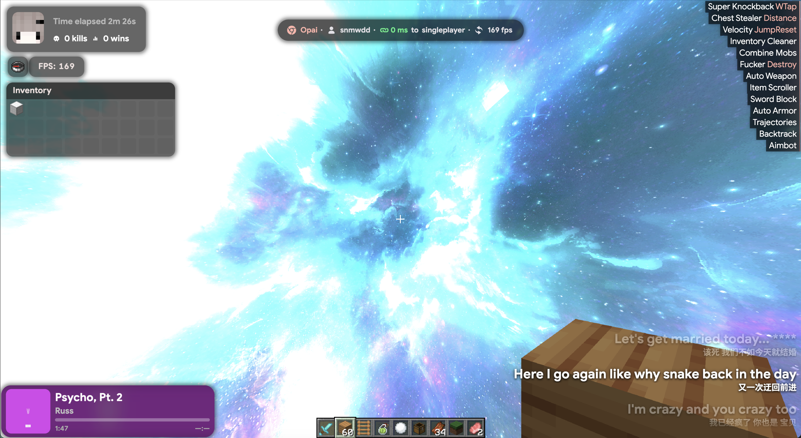

# OpaiBounce

为 LiquidBounce 制作的 Opai 风格主题与配套 LiquidScript。当前主题 **1.1.0**，脚本 **1.9.1**。

# 请必须装备脚本才能正常运行
https://github.com/snmwdd/OpaiBounce/tree/main/script




# [更多图片](https://github.com/snmwdd/OpaiBounce/tree/main/images简体中文.md)

在 ClickGUI 的 Configurations → Settings → Opai 可以调整阴影、模糊、灵动岛排版、配置是否恢复按键、独立 Ping，以及 ClickGUI 搜索胶囊。点击左下角的胶囊可搜索模块名和别名，选择结果会定位到模块。独立 Ping 每五秒测量当前多人连接的远端 IP，使用系统 ICMP。服务器不回复时显示 `—`。

## 环境

- Node.js 22+、npm。
- Python 3.11+。
- JDK 21+，确保 `java` 与 `javac` 在 PATH 中；音乐服务编译为 Java 21 字节码。
- 首次安装需要联网下载 npm 依赖和 Gson 2.11.0。Gson 从 Maven Central 下载并校验固定 SHA-256；游戏运行时由客户端提供 Gson。

## 开发与构建

```sh
npm ci
npm run dev
```

浏览器可使用 `http://localhost:5173/#/title?static&preview` 查看主菜单。实时游戏数据与原生绘制需要 LiquidBounce 和配套脚本。

```sh
npm run check       # Svelte / TypeScript 检查
npm test            # 脚本隔离测试
npm run test:music  # Java 协议、频谱和歌词测试，不使用真实账号
npm run build      # 从源码构建音乐服务和主题
npm run verify     # 校验描述文件、资源哈希和音乐源码包
npm run package    # 重新构建并生成主题 + 单份脚本的安装包与源码包
```

可通过 `python3 tools/build_music.py --gson /path/to/gson-2.11.0.jar` 使用已有依赖。浏览器回归需要先构建，再安装 Playwright Chromium：

```sh
npx playwright install chromium
npm run test:browser
```

截图和运行报告生成在 `reports/`，测试结果在 `test-results/`，均被 Git 忽略。自动化检查不代表 Windows / macOS 游戏内性能或画面已通过实机验收。

## 安装

从 [GitHub Releases](https://github.com/snmwdd/OpaiBounce/releases/latest) 下载 `OpaiBounce-1.1.0.zip`，也可以用 `npm run package` 自行构建。

1. 在游戏内执行 `.client theme browse`，将安装包 `themes/opai` 中的整个 `opai` 文件夹放入打开的主题目录。
2. 安装 LiquidBounce 官方 Script API 扩展。执行 `.script browse`，将安装包 `scripts/OpaiBounceScript.js` 放入脚本目录，只保留一份该脚本。
3. 完全退出并重新启动游戏，再执行 `.client theme set opai`。

桥接原生接口按 **LiquidBounce Nextgen 0.41.1 / Minecraft 26.3** 实现；对应客户端需要 **Java 25+**。其他版本需要重新验证接口兼容性。主题和脚本应一起更新。

脚本提供服务器地址 / Ping、实体预览和 Opai Nametags，音乐通过原生 `TritiumMusic` 模块配置。箱子隐藏界面和鼠标解锁使用 ChestStealer 自身的 SilentScreen / UnlockCursor 设置。

在 ClickGUI 的 Misc 中开启 `Anti-cheat` 后，本地聊天显示各项检查的 VL 和「观看玩家」。观看仅切换本机摄像头，玩家离开加载区域时会自动退出。每项检查可单独开关，`Flag Interval Seconds` 按玩家和检查项限制告警频率。`VL Above 10 To Alert` 默认是 `1`，总 VL 到 11 时发三条红色提示并显示红色骷髅。远程 Scaffold BPS 对可归因的放置使用两秒窗口，超过 3.5 BPS 加 VL；Telly Scaffold 另检查重复跳搭。AutoClicker Detection 和 AimAssist Detection 默认开启，Blink、FastMine、NoFall 和 Protocol 默认关闭。服务器插件和网络状况会影响客户端检测。观看和数据包检测需要安装同版本的完整主题。

达到告警门槛的 UUID 会按服务器地址或单人世界保存。玩家重进后，头顶红色骷髅和原版 Tab 名字前的红色 `*` 会恢复。实时 VL 继续衰减。关闭 Anti-cheat 时隐藏标记，重新开启后恢复。

主题启动后持续四秒收不到脚本心跳时，会提示从 [GitHub Releases](https://github.com/snmwdd/OpaiBounce/releases) 下载配套脚本。

音乐服务只监听随机本地回环端口，使用每次启动生成的令牌。账号会话和偏好保存在客户端数据目录 `opai-music/`，不属于本仓库。卸载脚本会关闭服务与音频。音乐来源受提供方可用性和账号权限影响。

## 来源与许可

主题及集成基于 LiquidBounce，代码许可见 [LICENSE](LICENSE)。Opai / Samsara 资源与原有声明见 [LICENSE-OPAI-SHELL](LICENSE-OPAI-SHELL) 和 [NOTICE.md](NOTICE.md)。原生音乐服务保留 Tritium Music、DangoMusic、JLayer、jFLAC 的源码与声明，见 [music/UPSTREAM.md](music/UPSTREAM.md)。QR 编码许可见 `public/music/LICENSE-QRCODE`；旗帜等资源的许可随资源保留。

GD 音乐台（music.gdstudio.xyz）的服务条款与代码许可独立，原提供方声明为非商业学习使用。Minecraft 版本图片、字体及其他第三方素材保留各自权利与来源，不因本仓库的 GPL 声明而被重新授权。

这是非官方主题移植，与上述上游项目无隶属关系。
