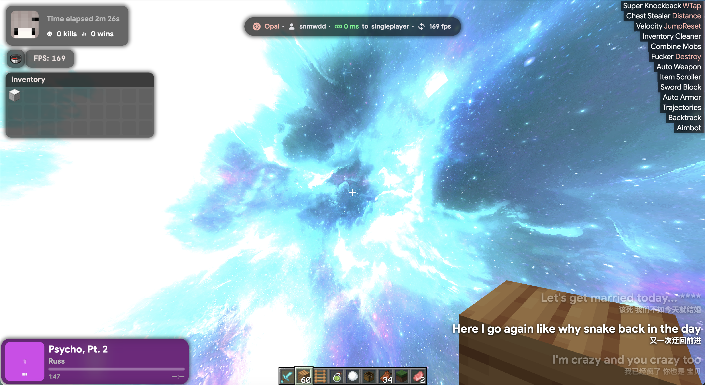

# OpaiBounce

为 LiquidBounce 制作的 Opai 风格主题与配套 LiquidScript。当前主题 **1.1.4**，脚本 **1.10.2**。

# 请必须装备脚本才能正常运行
https://github.com/snmwdd/OpaiBounce/tree/main/script




# [更多图片](https://github.com/snmwdd/OpaiBounce/tree/main/images简体中文.md)

在 ClickGUI 的 Configurations → Settings → Opai 可以调整阴影、模糊、灵动岛和目标 HUD 排版（New / Old / IDK）、Nametag 与床显示的独立距离滑动条（8–256 格）、HUD 背景、配置是否恢复按键、独立 Ping，以及 ClickGUI 搜索胶囊。点击左下角的胶囊可搜索模块名和别名，选择结果会定位到模块。独立 Ping 每五秒测量当前多人连接的远端 IP，使用系统 ICMP。服务器不回复时显示 `—`。

## 环境

- Node.js 22+、npm。
- Python 3.11+。
- JDK 21+，确保 `java` 与 `javac` 在 PATH 中；音乐服务编译为 Java 21 字节码。
- 首次安装需要联网下载 npm 依赖和 Gson 2.11.0。Gson 从 Maven Central 下载并校验固定 SHA-256；游戏运行时由客户端提供 Gson。

## 开发与构建

```sh
npm ci
npm run dev
```

浏览器可使用 `http://localhost:5173/#/title?static&preview` 查看主菜单。实时游戏数据与原生绘制需要 LiquidBounce 和配套脚本。

```sh
npm run check       # Svelte / TypeScript 检查
npm test            # 脚本隔离测试
npm run test:music  # Java 协议、频谱和歌词测试，不使用真实账号
npm run build      # 从源码构建音乐服务和主题
npm run verify     # 校验描述文件、资源哈希和音乐源码包
npm run package    # 重新构建并生成主题 + 单份脚本的安装包与源码包
```

可通过 `python3 tools/build_music.py --gson /path/to/gson-2.11.0.jar` 使用已有依赖。浏览器回归需要先构建，再安装 Playwright Chromium：

```sh
npx playwright install chromium
npm run test:browser
```

截图和运行报告生成在 `reports/`，测试结果在 `test-results/`，均被 Git 忽略。自动化检查不代表 Windows / macOS 游戏内性能或画面已通过实机验收。

## 安装

从 [GitHub Releases](https://github.com/snmwdd/OpaiBounce/releases) 下载同版本的主题和脚本，或在当前源码运行 `npm run package` 生成 `release/OpaiBounce-1.1.4.zip`。

1. 在游戏内执行 `.client theme browse`，将安装包 `themes/opai` 中的整个 `opai` 文件夹放入打开的主题目录。
2. 安装 LiquidBounce 官方 Script API 扩展。执行 `.script browse`，将安装包 `scripts/OpaiBounceScript.js` 放入脚本目录，只保留一份该脚本。
3. 完全退出并重新启动游戏，再执行 `.client theme set opai`。

桥接原生接口按 **LiquidBounce Nextgen 0.41.1 / Minecraft 26.3** 实现；对应客户端需要 **Java 25+**。其他版本需要重新验证接口兼容性。主题和脚本应一起更新。

脚本提供服务器地址 / Ping、实体预览和 Opai Nametags，音乐通过原生 `TritiumMusic` 模块配置。箱子隐藏界面和鼠标解锁使用 ChestStealer 自身的 SilentScreen / UnlockCursor 设置。

在 ClickGUI 的 Misc 中开启 `Anti-cheat` 后，本地聊天显示 VL 和 `Watch` 观看入口。每项检查注册为原生可开关设置组，通过右侧箭头展开，参数使用短英文名，可调整阈值、时间窗口、告警间隔及每次增加的 VL。`Cheater VL` 直接指定标记门槛，默认 11。`Reset VL` 默认关闭，开启后显示 `Reset Interval (s)`，默认 30 秒，可设为 5–600 秒。从玩家本轮第一次触发检查开始计时，到期清空该玩家总 VL 和各项 VL，保留已保存标记。保留旧配置开关和按服务器保存的标记。`Auto Throw` 检查持续瞄准玩家时的高频投掷，`Auto Bow` 检查可归属到弓箭使用者、靠近或命中自己的箭。`Telly Scaffold` 覆盖上升阶段及刚落地后的方块更新。服务器插件和网络状况会影响观察式检测。

`.hack add <player>` 添加标记，`.hack delete <player>` 删除标记，`.hack list [page]` 列出标记。点击列表中的 `[X]` 可直接移除，并清除该玩家当前 VL。关闭检测模块时仍可使用命令管理标记。主题和脚本需要一起更新。

达到告警门槛的 UUID 会按服务器地址或单人世界保存。玩家重进后，头顶红色骷髅和原版 Tab 名字前的红色 `*` 会恢复。实时 VL 按 `Reset VL` 设置处理。关闭 Anti-cheat 时隐藏标记，重新开启后恢复。

主题启动后持续四秒收不到脚本心跳时，会提示从 [GitHub Releases](https://github.com/snmwdd/OpaiBounce/releases) 下载配套脚本。

音乐服务只监听随机本地回环端口，使用每次启动生成的令牌。账号会话和偏好保存在客户端数据目录 `opai-music/`，不属于本仓库。卸载脚本会关闭服务与音频。音乐来源受提供方可用性和账号权限影响。

## 来源与许可

主题及集成基于 LiquidBounce，代码许可见 [LICENSE](LICENSE)。Opai / Samsara 资源与原有声明见 [LICENSE-OPAI-SHELL](LICENSE-OPAI-SHELL) 和 [NOTICE.md](NOTICE.md)。原生音乐服务保留 Tritium Music、DangoMusic、JLayer、jFLAC 的源码与声明，见 [music/UPSTREAM.md](music/UPSTREAM.md)。QR 编码许可见 `public/music/LICENSE-QRCODE`；旗帜等资源的许可随资源保留。

GD 音乐台（music.gdstudio.xyz）的服务条款与代码许可独立，原提供方声明为非商业学习使用。Minecraft 版本图片、字体及其他第三方素材保留各自权利与来源，不因本仓库的 GPL 声明而被重新授权。

这是非官方主题移植，与上述上游项目无隶属关系。

## 新增显示与检查

- `IDK` 目标 HUD 使用方形头像、像素文字、居中的血量百分比和浅紫色血条；New、Old 保持原有布局。
- 原生 `BedPlates` 开启后，床保护改为圆角卡片、横向方块图标与底部保护状态；无保护时仅显示 `Not Protected`。第一层的顶部和侧面完整覆盖时显示 `Fully Protected`，地板不算保护层。
- `Inventory Drop` 在 5 秒内超过 5 次丢弃后累计 VL。整组物品只算一次，窗口、次数、来源半径、告警间隔和 VL 都可单独调整。没有归属信息时，通过出生位置、初速度和近期玩家位置推断来源，并排除重复实体、多人重叠与近期方块掉落；推断提示标注 `estimated source`。正常快速清背包也可能触发，不能据此确定作弊或知道对方是否打开背包。
